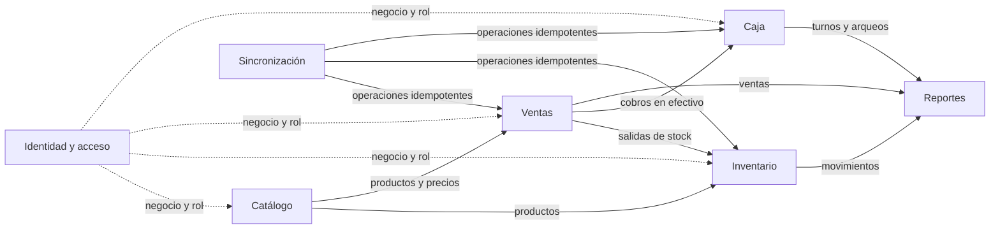

# Mapa de contextos de VSD Stock

Cómo se parte el dominio en partes que se pueden entender, probar y construir por separado, y cómo se hablan
entre sí. Un **contexto** es una parte del sistema donde cada palabra del [glosario](glosario.md) tiene un
solo significado.

> **Está congelado** para lo que entra en la entrega (ADR 0020): los contextos, sus fronteras y sus relaciones no
> cambian sin otro ADR que lo reemplace. Las tablas que los implementan están en el
> [modelo de datos](modelo-de-datos.md).

## El mapa

Una flecha va de quien **da** a quien **recibe**, y el que recibe se acomoda a lo que el otro publica y no al
revés. La línea punteada es lo que todos reciben de _Identidad y acceso_; se dibuja hacia los cuatro contextos de
negocio y se omite hacia los otros dos para no llenar el mapa.

## Los contextos

| Contexto               | De qué se ocupa                                                                    | Términos del glosario                                                                                                                    | En la entrega                                     |
| ---------------------- | ---------------------------------------------------------------------------------- | ---------------------------------------------------------------------------------------------------------------------------------------- | ------------------------------------------------- |
| **Identidad y acceso** | Quién es el negocio, quién es la persona, qué puede hacer y desde qué dispositivo. | Negocio, Sucursal, Usuario, Rol, Dispositivo, Sesión                                                                                     | Sí                                                |
| **Catálogo**           | Qué se vende: productos, cómo se cuentan, cuánto cuestan y qué impuesto llevan.    | Producto, Variante, Categoría, Unidad de medida, Precio, Impuesto, Código de barras, SKU                                                 | Sí                                                |
| **Inventario**         | Cuánta mercancía hay y por qué cambió: el libro de movimientos.                    | Bodega, Movimiento de stock, Existencia, Requiere ajuste, Ajuste, Compra, Proveedor, Alerta de stock mínimo, Conteo físico               | Sí, sin conteo físico                             |
| **Ventas**             | La transacción en el mostrador: qué se vendió, a qué precio y cómo se pagó.        | Venta, Línea de venta, Pago, Descuento, Anulación, Devolución, Cliente, Fiado                                                            | Sí, sin fiado ni devoluciones parciales           |
| **Caja**               | El efectivo: turnos, cuánto debería haber y cuánto hay.                            | Turno de caja, Arqueo, Venta tardía, Movimiento de caja, Folio                                                                           | Sí                                                |
| **Reportes**           | Vistas derivadas de lo que ya pasó. No escriben nada.                              | Reporte, Flujo de caja, Gasto, Cuenta por cobrar y por pagar                                                                             | Mínimos; sin gastos ni cuentas                    |
| **Sincronización**     | Que lo hecho sin conexión llegue al servidor una sola vez y sin pisarse.           | Operación, operationId, Cola de operaciones, Copia de lectura, Sincronización, Estado de conexión, Comprobación de salud, Clase de fallo | Sí (frontend y un punto de entrada en el backend) |

Los términos **transversales** (_Dinero_, _Moneda_, _Auditoría_, _Datos personales_) no pertenecen a un contexto:
los usan todos, y por eso su definición vive en un solo lugar, en el glosario.

## Cómo se hablan

| Quién → a quién                           | Qué le da                                                                                                 | Cómo                                                                       |
| ----------------------------------------- | --------------------------------------------------------------------------------------------------------- | -------------------------------------------------------------------------- |
| Identidad y acceso → todos                | El negocio y el rol de quien llama, sacados del **token verificado**, nunca de lo que declare el cliente. | Lo fija la API en cada transacción; la base lo hace cumplir (ADR 0005).    |
| Catálogo → Inventario y Ventas            | Qué productos existen y a qué precio.                                                                     | Se refieren al producto por su identificador (UUID, ADR 0004).             |
| Ventas → Inventario                       | Cada venta saca mercancía: genera movimientos de stock. Una venta ya hecha nunca se rechaza (ADR 0009).   | En la misma transacción que la venta (ADR 0013).                           |
| Ventas → Caja                             | Un cobro en efectivo entra al turno abierto. Anular una venta compensa, no borra.                         | En la misma transacción que la venta (ADR 0013).                           |
| Inventario, Ventas, Caja → Reportes       | Los hechos de los que se derivan las cifras.                                                              | Los reportes **leen**; no hay nada que sincronizar hacia atrás.            |
| Sincronización → Ventas, Inventario, Caja | Operaciones del dispositivo, cada una con su `operationId`.                                               | Cada operación es una unidad de trabajo; reenviarla no duplica (ADR 0009). |

## Lo que ya está decidido y condiciona el mapa

- **El aislamiento entre negocios lo impone la base de datos**, no cada consulta (ADR 0005): ningún contexto
  puede saltárselo.
- **El inventario es un libro de movimientos** (ADR 0009): _Inventario_ nunca guarda «un número» que otro
  contexto sobrescriba, y dos cajas sin conexión que venden lo mismo se suman.
- **Un backend, una imagen:** el backend se empaqueta como una sola imagen (ADR 0011) y los únicos
  repositorios que se separan son el backend y el frontend (ADR 0001). Mientras otro ADR no diga lo contrario,
  los contextos son módulos del mismo programa con sus fronteras, no servicios separados.
- **El dominio no conoce a nadie de afuera** (ADR 0003): ningún contexto importa NestJS, Prisma ni React.

## La entrega y el orden en que se construye

La fecha de entrega es **2026-11-16** y no se mueve. El orden previsto sigue las dependencias del mapa:

| Ciclo | Fechas                          | Qué entra                                                       |
| ----- | ------------------------------- | --------------------------------------------------------------- |
| 0     | 19 al 23 de octubre             | Fundaciones: repositorios, CI, ADR, glosario, esqueleto andante |
| 1     | 26 al 28 de octubre             | Modelado y contratos: se congela el dominio con ADR             |
| 2     | 29 de octubre al 4 de noviembre | Identidad, catálogo e inventario                                |
| 3     | 5 al 11 de noviembre            | Punto de venta, caja y motor offline                            |
| 4     | 12 y 13 de noviembre            | Reportes mínimos y cierre                                       |

**Fuera de la entrega** (existe el vocabulario, no el código): fiado y cuentas por cobrar y por pagar, gastos y
flujo de caja completo, conteo físico, devoluciones parciales, sucursales y bodegas operativas más allá de una, y
exportar o eliminar la cuenta (queda como deuda con su ADR). Si el plazo aprieta, se recorta antes la mascota,
después los reportes y después las alertas; **la calidad no se recorta**.

## Preguntas resueltas

Las ocho preguntas que dejó abiertas el Ciclo 0 las cerró el Ciclo 1, cada una con su ADR y, donde se pudo, con una
prueba contra PostgreSQL real, una simulación o un navegador real.

| #   | Pregunta                                                                                     | Decisión                                                                                                                                                                         |
| --- | -------------------------------------------------------------------------------------------- | -------------------------------------------------------------------------------------------------------------------------------------------------------------------------------- |
| 1   | ¿Hay variantes de producto, o una unidad de medida basta para el primer negocio?             | No hay variantes: cada presentación es otro producto con su código. Seis unidades y cantidades en milésimas. [ADR 0015](../adr/0015-catalogo-unidades-cantidades-y-codigos.md)   |
| 2   | ¿Cómo se mantiene el saldo de existencias derivado sin perder la idempotencia?               | Un disparador lo mantiene en la misma transacción y la aplicación solo lo lee. [ADR 0013](../adr/0013-existencia-derivada-y-venta-como-una-sola-operacion.md)                    |
| 3   | ¿Cómo se numeran los folios para que dos cajas sin conexión no choquen, y qué ve la persona? | Código de dispositivo más una serie (`AA-000142`); no cambia al sincronizar. [ADR 0016](../adr/0016-folios-por-dispositivo-y-hora-corregida.md)                                  |
| 4   | ¿Qué hora vale en una operación sin conexión y cuál guarda el servidor?                      | La del dispositivo corregida con la diferencia medida contra el servidor; se guardan tres horas y las marcas. [ADR 0016](../adr/0016-folios-por-dispositivo-y-hora-corregida.md) |
| 5   | ¿El impuesto va en el producto o en la línea de venta, y cómo se redondea?                   | La tarifa va en el producto y se copia a la línea; el IVA va incluido y se redondea con una sola regla. [ADR 0014](../adr/0014-dinero-impuestos-y-redondeo.md)                   |
| 6   | ¿Qué puede hacer exactamente cada rol?                                                       | Tres roles fijos y 23 acciones, negadas por omisión. [ADR 0017](../adr/0017-roles-permisos-y-modo-sin-conexion.md)                                                               |
| 7   | ¿Qué se puede y qué no se puede hacer sin conexión, funcionalidad por funcionalidad?         | El mostrador sigue; la administración espera la conexión. [ADR 0017](../adr/0017-roles-permisos-y-modo-sin-conexion.md)                                                          |
| 8   | ¿Una venta y sus movimientos de stock y de caja son realmente una sola transacción?          | Sí: todo o nada, y reenviarla no duplica. [ADR 0013](../adr/0013-existencia-derivada-y-venta-como-una-sola-operacion.md)                                                         |

Y lo que el [ADR 0009](../adr/0009-motor-offline-y-libro-de-movimientos.md) dejó para este ciclo: el cifrado local y
cuándo se olvida lo guardado, en el [ADR 0018](../adr/0018-cifrado-local-y-olvido-del-dispositivo.md); la forma de
hablar de la API, en el [ADR 0019](../adr/0019-convenciones-de-la-api.md).
