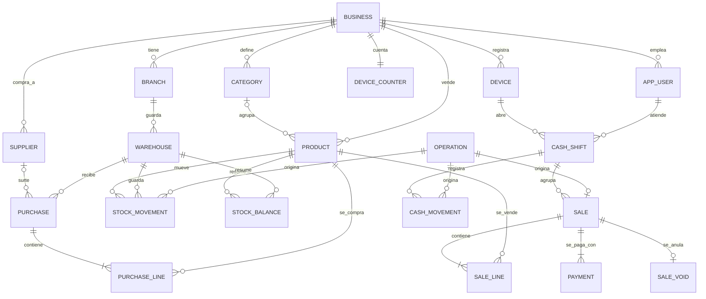

# Modelo de datos de VSD Stock

Las tablas de la entrega, cómo se llaman y cómo se relacionan. **Está congelado** por el
[ADR 0020](../adr/0020-se-congela-el-modelo-del-dominio.md): quien quiera cambiar una tabla, una relación o una
regla de nombres de este documento escribe un ADR que lo reemplace. Lo que no aparece aquí no se construye antes
del 2026-11-16.

> **Es el modelo, no el esquema de Prisma.** El Ciclo 2 lo traduce a `schema.prisma` y a migraciones, empezando por
> las pruebas que ya existen: los esquemas de juguete de `test/integration/support/*-design.ts` se apuntan a las
> tablas reales. Una prueba (`test/docs/modelo.spec.ts`) comprueba que todas las tablas que esos esquemas construyen
> están en este documento, que el diagrama dibuja exactamente las tablas de la lista y que dibuja cada clave foránea
> que esos esquemas exigen. Las demás relaciones del diagrama no las vigila ninguna prueba todavía (el Ciclo 2 las
> convierte en claves foráneas reales): las fija la revisión.

## Reglas de nombres

- **Tablas y columnas en inglés, `snake_case`, en singular:** `stock_movement`, `unit_price`. La única excepción es
  la columna de aislamiento, **`id_negocio`**, que ya fijó el ADR 0005 y que lleva **toda** tabla con datos de un
  negocio.
- **Clave primaria `id uuid`** (ADR 0004). Una clave foránea se llama `<tabla>_id` y, como la base debe impedir que
  una fila apunte a otro negocio, **es compuesta con `id_negocio`**: `FOREIGN KEY (id_negocio, shift_id)`.
- **Dinero en `bigint` de pesos** (`unit_price`, `total`), **cantidades en `bigint` de milésimas** (`..._milli`) y
  **tarifas en `integer` de puntos básicos** (`..._bp`) (ADR 0014 y 0015). Nada de `numeric` ni de `float`.
- **Instantes en `timestamptz`** con nombre `..._at` (`occurred_at`); el día del negocio no se guarda: se calcula en
  la hora de Colombia al leer (ADR 0016).
- **RLS habilitado y forzado en toda tabla con `id_negocio`** (ADR 0005).
- **Nada se borra ni se edita donde hay historia:** los movimientos de stock, las ventas y sus anulaciones son
  inmutables (ADR 0009 y 0013); un producto se archiva (`active = false`) y conserva sus códigos (ADR 0015).
- **Los reportes no son tablas:** son vistas o consultas sobre lo de abajo.

## El diagrama

## Las tablas

Cada fila dice en qué contexto vive la tabla (ver el [mapa de contextos](mapa-de-contextos.md)), qué guarda y qué
regla ya está demostrada por una prueba contra PostgreSQL real o por el dominio.

| Tabla            | Contexto           | Qué guarda                                                                                                                                                                                    |
| ---------------- | ------------------ | --------------------------------------------------------------------------------------------------------------------------------------------------------------------------------------------- |
| `business`       | Identidad y acceso | El negocio. Su `id` es el valor de `id_negocio` de todo lo demás. La zona horaria es una constante (`America/Bogota`).                                                                        |
| `branch`         | Identidad y acceso | Un local del negocio. Se modela, pero la entrega opera con uno solo.                                                                                                                          |
| `app_user`       | Identidad y acceso | Una persona con acceso: su rol (`owner`, `admin`, `cashier`) y si está activa (ADR 0017). Cómo se identifica es del Ciclo 2.                                                                  |
| `device`         | Identidad y acceso | Un dispositivo registrado y su código corto (`AA`, `AB`...), único por negocio y nunca reutilizado (ADR 0016).                                                                                |
| `device_counter` | Identidad y acceso | El contador por negocio que reparte los códigos de dispositivo sin repetirlos aunque se registren a la vez (ADR 0016).                                                                        |
| `category`       | Catálogo           | Una agrupación opcional de productos, de un solo nivel; el nombre es único por negocio.                                                                                                       |
| `product`        | Catálogo           | Nombre, SKU, código de barras opcional, unidad, precio con IVA incluido y tarifa. SKU y código únicos por negocio, archivados incluidos (ADR 0015).                                           |
| `warehouse`      | Inventario         | Dónde está la mercancía. Se modela, pero la entrega opera con una bodega por local.                                                                                                           |
| `supplier`       | Inventario         | A quien se le compra. Solo nombre y datos de contacto opcionales.                                                                                                                             |
| `purchase`       | Inventario         | Una entrada de mercancía: bodega, proveedor opcional y la operación que la originó.                                                                                                           |
| `purchase_line`  | Inventario         | Un producto, una cantidad en milésimas y un costo de la compra.                                                                                                                               |
| `stock_movement` | Inventario         | El libro: un cambio firmado de la existencia de un producto, con su motivo. Solo se agrega (ADR 0013).                                                                                        |
| `stock_balance`  | Inventario         | La existencia de un producto en una bodega, derivada del libro por un disparador en la misma transacción; la aplicación solo la lee (ADR 0013).                                               |
| `sale`           | Ventas             | Una venta: su folio (`AA-000142`), su turno, su total y la marca «requiere ajuste». Inmutable (ADR 0009, 0013 y 0016).                                                                        |
| `sale_line`      | Ventas             | Un producto, una cantidad, el precio y la tarifa que tenían al vender y el descuento de la línea (ADR 0014).                                                                                  |
| `payment`        | Ventas             | Con qué se pagó: efectivo, o el registro manual de tarjeta o transferencia. Sin pasarela de pagos.                                                                                            |
| `sale_void`      | Ventas             | La anulación de una venta: no borra nada, agrega los movimientos que compensan (ADR 0009).                                                                                                    |
| `cash_shift`     | Caja               | Del momento en que una persona abre la caja hasta que la cierra y hace el arqueo. Cerrarlo espera a las ventas en curso (ADR 0013).                                                           |
| `cash_movement`  | Caja               | Un ingreso o un egreso de efectivo: el cobro de una venta o un movimiento fuera de venta. Positivo.                                                                                           |
| `operation`      | Sincronización     | Una fila por operación que llega de un dispositivo: su `operation_id` es la clave primaria con el negocio (idempotencia), y guarda la hora cruda, la efectiva y las marcas (ADR 0013 y 0016). |

## Lo que está fuera de la entrega

Existe el vocabulario en el [glosario](glosario.md), pero **no hay tabla** en esta versión:

| Concepto               | Nombre previsto  | Por qué                                                                                |
| ---------------------- | ---------------- | -------------------------------------------------------------------------------------- |
| Clientes               | `customer`       | Sin fiado no hace falta saber a quién se vende; además evita guardar datos personales. |
| Cuentas por cobrar     | `receivable`     | Dependen del fiado, que queda fuera de la entrega.                                     |
| Cuentas por pagar      | `payable`        | Ídem, del lado de los proveedores.                                                     |
| Gastos                 | `expense`        | El flujo de caja completo queda fuera de la entrega.                                   |
| Conteo físico          | `physical_count` | Se corrige con ajustes de inventario mientras tanto.                                   |
| Devoluciones parciales | `sale_return`    | Se anula la venta completa (ADR 0009).                                                 |

Agregar cualquiera de ellas es un ADR nuevo y una migración; el modelo está pensado para que no obligue a rehacer
las demás.

## Lo que el esquema real cambia respecto de las pruebas

Los esquemas de juguete de los ADR 0013 a 0016 son más pequeños que el modelo; la migración real del Ciclo 2 los
completa **sin cambiar sus reglas**:

- `stock_movement` y `stock_balance` llevan `warehouse_id` (hoy hay una bodega por local) y la clave del saldo es
  `(id_negocio, warehouse_id, product_id)`.
- `sale` lleva `folio`, `folio_reported` y `folio_conflict` (ADR 0016); la hora, las marcas y el origen del
  dispositivo y de la persona viven en `operation`, no repetidos en cada tabla.
- `product` lleva `category_id` (opcional) y `min_stock_milli` (opcional, para la alerta de stock mínimo).
- Toda tabla con `id_negocio` lleva RLS forzado y claves foráneas compuestas, como las de las pruebas.
