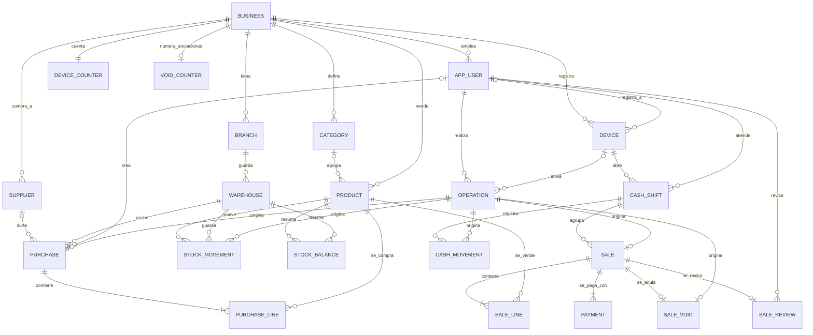

# Modelo de datos de VSD Stock

Las tablas de la entrega, cómo se llaman y cómo se relacionan. **Está congelado** por el
[ADR 0020](../adr/0020-se-congela-el-modelo-del-dominio.md): quien quiera cambiar una tabla, una relación o una
regla de nombres de este documento escribe un ADR que lo reemplace. Lo que no aparece aquí no se construye antes
del 2026-11-16.

> **Es el modelo; el esquema de Prisma y las migraciones lo hacen real** (ADR 0021): `prisma/schema.prisma` y la
> migración `prisma/migrations/20261017120000_modelo_inicial`. Tres pruebas lo mantienen honesto:
> `test/docs/modelo.spec.ts` comprueba que las tablas que crea la migración son exactamente las de este documento y
> que el diagrama dibuja exactamente las relaciones entre tablas que la migración exige con claves foráneas;
> `test/integration/schema.integration.spec.ts` comprueba, contra PostgreSQL real, que la base es lo que aquí se dice;
> y `test/integration/schema-drift.integration.spec.ts` comprueba que `schema.prisma` y la base migrada no se separan.

## Reglas de nombres

- **Tablas y columnas en inglés, `snake_case`, en singular:** `stock_movement`, `unit_price`. La única excepción es
  la columna de aislamiento, **`id_negocio`**, que ya fijó el ADR 0005 y que lleva **toda** tabla con datos de un
  negocio.
- **Clave primaria `id uuid`** (ADR 0004). Una clave foránea se llama `<tabla>_id` y, como la base debe impedir que
  una fila apunte a otro negocio, **es compuesta con `id_negocio`**: `FOREIGN KEY (id_negocio, shift_id)`.
- **Dinero en `bigint` de pesos** (`unit_price`, `total`), **cantidades en `bigint` de milésimas** (`..._milli`) y
  **tarifas en `integer` de puntos básicos** (`..._bp`) (ADR 0014 y 0015). Nada de `numeric` ni de `float`.
- **Instantes en `timestamptz`** con nombre `..._at` (`occurred_at`); el día del negocio no se guarda: se calcula en
  la hora de Colombia al leer (ADR 0016).
- **RLS habilitado y forzado en toda tabla con `id_negocio`** (ADR 0005).
- **Nada se borra ni se edita donde hay historia:** los movimientos de stock, las ventas y sus anulaciones son
  inmutables (ADR 0009 y 0013); un producto se archiva (`active = false`) y conserva sus códigos (ADR 0015).
- **Los reportes no son tablas:** son vistas o consultas sobre lo de abajo.

## El diagrama

## Las tablas

Cada fila dice en qué contexto vive la tabla (ver el [mapa de contextos](mapa-de-contextos.md)), qué guarda y qué
regla ya está demostrada por una prueba contra PostgreSQL real o por el dominio.

| Tabla            | Contexto           | Qué guarda                                                                                                                                                                                                       |
| ---------------- | ------------------ | ---------------------------------------------------------------------------------------------------------------------------------------------------------------------------------------------------------------- |
| `business`       | Identidad y acceso | El negocio. Su `id` es el valor de `id_negocio` de todo lo demás. La zona horaria es una constante (`America/Bogota`).                                                                                           |
| `branch`         | Identidad y acceso | Un local del negocio. Se modela, pero la entrega opera con uno solo.                                                                                                                                             |
| `app_user`       | Identidad y acceso | Una persona con acceso: su rol (`owner`, `admin`, `cashier`) y si está activa (ADR 0017). Cómo se identifica es del Ciclo 2.                                                                                     |
| `device`         | Identidad y acceso | Un dispositivo registrado y su código corto (`AA`, `AB`...), único por negocio y nunca reutilizado (ADR 0016).                                                                                                   |
| `device_counter` | Identidad y acceso | El contador por negocio que reparte los códigos de dispositivo sin repetirlos aunque se registren a la vez (ADR 0016).                                                                                           |
| `void_counter`   | Ventas             | El contador por negocio que reparte los números de las anulaciones sin saltos y en orden; nace con la primera anulación (ADR 0036).                                                                              |
| `category`       | Catálogo           | Una agrupación opcional de productos, de un solo nivel; el nombre es único por negocio.                                                                                                                          |
| `product`        | Catálogo           | Nombre, SKU, código de barras opcional, unidad, precio con IVA incluido, tarifa y tipo tributario (gravado, exento o excluido, ADR 0034). SKU y código únicos por negocio, archivados incluidos (ADR 0015).      |
| `warehouse`      | Inventario         | Dónde está la mercancía. Se modela, pero la entrega opera con una bodega por local.                                                                                                                              |
| `supplier`       | Inventario         | A quien se le compra. Solo nombre y datos de contacto opcionales.                                                                                                                                                |
| `purchase`       | Inventario         | Una entrada de mercancía: bodega, proveedor opcional y la operación que la originó.                                                                                                                              |
| `purchase_line`  | Inventario         | Un producto, una cantidad en milésimas y un costo de la compra.                                                                                                                                                  |
| `stock_movement` | Inventario         | El libro: un cambio firmado de la existencia de un producto, con su motivo. Solo se agrega (ADR 0013).                                                                                                           |
| `stock_balance`  | Inventario         | La existencia de un producto en una bodega, derivada del libro por un disparador en la misma transacción; la aplicación solo la lee (ADR 0013).                                                                  |
| `sale`           | Ventas             | Una venta: su folio (`AA-000142`), su turno, su total y la marca «requiere ajuste». Inmutable (ADR 0009, 0013 y 0016).                                                                                           |
| `sale_line`      | Ventas             | Un producto, una cantidad, el precio, la tarifa y el tipo tributario que tenían al vender y el descuento de la línea (ADR 0014 y 0034).                                                                          |
| `payment`        | Ventas             | Con qué se pagó: efectivo, o el registro manual de tarjeta o transferencia. Sin pasarela de pagos.                                                                                                               |
| `sale_review`    | Ventas             | La revisión de una venta que pedía atención: quién la miró, cuándo y qué anotó. Una por venta y solo se agrega: revisar no cambia la venta (ADR 0027).                                                           |
| `sale_void`      | Ventas             | La anulación de una venta: no borra nada, agrega los movimientos que compensan (ADR 0009). Lleva su número de anulación por negocio, el de su folio `ANU-000001` (ADR 0036).                                     |
| `cash_shift`     | Caja               | Del momento en que una persona abre la caja hasta que la cierra y hace el arqueo. Cerrarlo espera a las ventas en curso (ADR 0013); un turno abierto por dispositivo y por persona, y quién lo cerró (ADR 0026). |
| `cash_movement`  | Caja               | Un ingreso o un egreso de efectivo: el cobro de una venta o un movimiento fuera de venta. Positivo.                                                                                                              |
| `operation`      | Sincronización     | Una fila por operación que llega de un dispositivo: su `operation_id` es la clave primaria con el negocio (idempotencia), y guarda la hora cruda, la efectiva y las marcas (ADR 0013 y 0016).                    |

## Lo que está fuera de la entrega

Existe el vocabulario en el [glosario](glosario.md), pero **no hay tabla** en esta versión:

| Concepto               | Nombre previsto  | Por qué                                                                                |
| ---------------------- | ---------------- | -------------------------------------------------------------------------------------- |
| Clientes               | `customer`       | Sin fiado no hace falta saber a quién se vende; además evita guardar datos personales. |
| Cuentas por cobrar     | `receivable`     | Dependen del fiado, que queda fuera de la entrega.                                     |
| Cuentas por pagar      | `payable`        | Ídem, del lado de los proveedores.                                                     |
| Gastos                 | `expense`        | El flujo de caja completo queda fuera de la entrega.                                   |
| Conteo físico          | `physical_count` | Se corrige con ajustes de inventario mientras tanto.                                   |
| Devoluciones parciales | `sale_return`    | Se anula la venta completa (ADR 0009).                                                 |

Agregar cualquiera de ellas es un ADR nuevo y una migración; el modelo está pensado para que no obligue a rehacer
las demás.

## Lo que el esquema real añade a los esquemas de juguete del Ciclo 1

Los esquemas de juguete de los ADR 0013 a 0016 eran más pequeños que el modelo. La migración real los completó
**sin cambiar sus reglas** (ADR 0021), y las especificaciones del Ciclo 1 corren ahora sobre estas tablas:

- `stock_movement` y `stock_balance` llevan `warehouse_id` (hoy hay una bodega por local) y la clave del saldo es
  `(id_negocio, warehouse_id, product_id)`.
- `sale` lleva `folio`, `folio_reported` y `folio_conflict` (ADR 0016); la hora, las marcas de la hora y el origen del
  dispositivo y de la persona viven en `operation`, no repetidos en cada tabla.
- `sale` lleva `flags` (ADR 0027), las marcas que el servidor le puso al aceptarla, con una lista cerrada que la base hace
  cumplir; `sale_line` y `payment` llevan `position`, el orden en que el dispositivo los vendió y los cobró.
- `product` lleva `category_id` (opcional) y `min_stock_milli` (opcional, para la alerta de stock mínimo).
- Toda tabla con `id_negocio` lleva RLS forzado y claves foráneas compuestas, como las de las pruebas.
- **Relaciones que el diagrama no dibujaba y la migración sí exige** (se corrigió el diagrama, ver ADR 0021):
  `operation` con la persona que la hizo y, si vino de uno, el dispositivo; `device` con la persona que lo
  registró; `purchase` con la persona que la creó y con su `operation`; `sale_void` con su `operation`; y `sale_review`
  con su venta y con la persona que la revisó.
- **`sale_review` y `void_counter` son las tablas que se suman al modelo congelado.** La primera la decide el
  [ADR 0027](../adr/0027-registro-de-ventas-y-atencion.md): revisar una venta de la bandeja «Requiere atención» no puede
  editar la venta (es historia inmutable, ADR 0009 y 0013), así que es otra fila. La segunda la decide el
  [ADR 0036](../adr/0036-las-anulaciones-tienen-su-propio-folio-consecutivo.md): el contador que da a cada anulación su número sin saltos.
- **Las columnas que aún no existen** (por ejemplo los desgloses de IVA de la venta) se agregan con la migración del
  ciclo que construye esa funcionalidad: una migración nueva, nunca la edición de una ya aplicada.
- `app_user` también sirve de invitación pendiente: mientras no se canjea, `auth_user_id` está vacío y guarda el hash
  del código y su vencimiento ([ADR 0023](../adr/0023-negocio-personas-e-invitaciones.md)). No hay una tabla más.
  El hash es **único en toda la base** (no por negocio) y dos políticas dejan a quien canjea ver y tomar solo esa
  fila; al canjear se borran el hash y el vencimiento.
